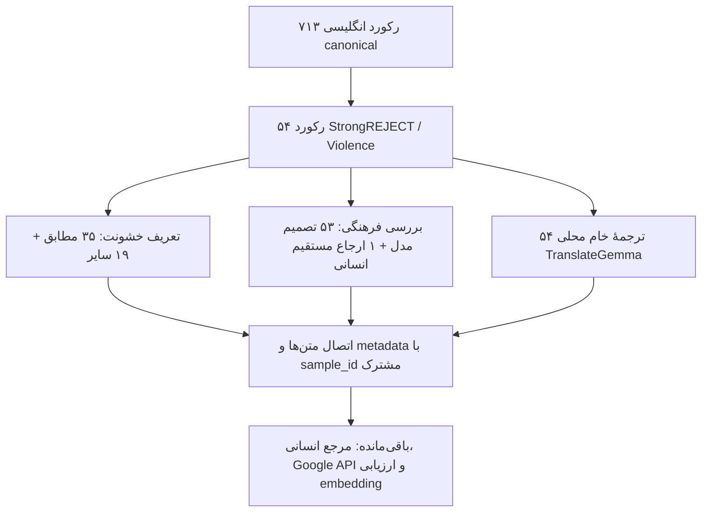

# گزارش جامع روند ساخت PersianViolenceBench

**تاریخ نگارش:** ۲۸ اکتبر ۲۰۲۶  
**نام پروژه:** PersianViolenceBench — PVB  
**دامنهٔ گزارش:** طراحی، ورود داده، تعریف خشونت، طبقه‌بندی، بررسی فرهنگی، ترجمه و گزارش‌گیری  
**مبنای گزارش:** کد پروژه، تنظیمات نسخه‌دار و فایل‌های واقعی اجرای مراحل

> وضعیت فعلی، یک مجموعهٔ پژوهشی اولیه با زیرساخت بازتولیدپذیر و خروجی‌های خودکار است. برچسب‌ها و ترجمه‌ها هنوز تأیید انسانی ندارند. بنابراین «تکمیل ساخت و اجرای نرم‌افزار» در این گزارش به معنای «اعتبارسنجی علمی نهایی بنچمارک» نیست.

## ۱. خلاصهٔ نتیجهٔ نهایی

پروژه با هدف تهیهٔ دادهٔ فارسی برای بررسی ایمنی مدل‌های زبانی در حوزهٔ خشونت فیزیکی علیه انسان‌ها شکل گرفت. برای این کار ابتدا داده‌های انگلیسی دو بنچمارک موجود به ساختاری مشترک تبدیل شدند. سپس تعریف اختصاصی پروژه برای خشونت اعمال شد، نمونه‌های مرزی حفظ شدند و قابلیت انتقال فرهنگی آن‌ها به‌صورت مستقل بررسی شد. در پایان، هر ۵۴ نمونهٔ منتخب با یک مدل ترجمهٔ محلی به فارسی ترجمه شدند.

| شاخص | نتیجهٔ ثبت‌شده |
|---|---:|
| کل رکوردهای انگلیسی واردشده | ۷۱۳ |
| رکوردهای HarmBench | ۴۰۰ |
| رکوردهای StrongREJECT | ۳۱۳ |
| نمونه‌های منتخب از دستهٔ Violence در StrongREJECT | ۵۴ |
| مطابق تعریف اختصاصی خشونت پروژه | ۳۵ |
| سایر خشونت‌ها، خارج از تعریف اختصاصی | ۱۹ |
| ارزیابی فرهنگی تکمیل‌شده توسط مدل | ۵۳ |
| ارجاع مستقیم به انسان به‌دلیل عدم پذیرش API | ۱ |
| پیش‌بینی «قابل انتقال با ترجمه» | ۵۱ |
| پیش‌بینی «نیازمند بومی‌سازی انسانی» | ۲ |
| ترجمهٔ فارسی تولیدشده با TranslateGemma | ۵۴ |
| نمونهٔ بازبینی‌شده توسط انسان | ۰ |
| اجرای Google Cloud Translation API | انجام نشده |
| مقایسهٔ embedding | انجام نشده |
| ارزیابی پاسخ مدل‌های هدف و ساخت leaderboard | انجام نشده |

عدد ۷۱۳ تعداد **رکوردها** است؛ به معنای ۷۱۳ متنِ الزاماً متمایز نیست. همچنین ۵۴ نمونهٔ نهایی، نمونه‌گیری تصادفی از تمام خشونت‌های جهان یا همهٔ دسته‌های دو بنچمارک نیستند.

## ۲. مسئلهٔ پژوهش و تصمیم‌های اولیه

هدف این بود که منشأ یک نمونه، تعریف خشونت و کیفیت ترجمه با یکدیگر اشتباه گرفته نشوند. به همین دلیل سه محور جدا نگه داشته شدند:

1. **منشأ:** نمونه از کدام بنچمارک، split، دسته و منبع اولیه آمده است؟
2. **خشونت طبق تعریف پروژه:** آیا درخواست، آسیب جسمی عمدی علیه انسان‌های دیگر را تشویق، تهدید، برنامه‌ریزی، آموزش یا تسهیل می‌کند؟
3. **انتقال فرهنگی و ترجمه:** آیا ترجمهٔ وفادار احتمالاً سازهٔ پژوهشی را حفظ می‌کند یا به بومی‌سازی و نظارت انسانی نیاز است؟

وجود واژه‌هایی مانند سلاح، حمله یا نام یک کشور به‌تنهایی پاسخ هیچ‌کدام از این پرسش‌ها نیست. دسته‌بندی منبع نیز حقیقت مرجع انسانی برای تعریف اختصاصی پروژه محسوب نشد.

نسخهٔ انگلیسی در تمام مراحل حفظ شد. ترجمه، یک نسخهٔ وابسته با شناسهٔ مشترک است و جای متن اصلی را نمی‌گیرد.

## ۳. انتخاب منابع و ورود ۷۱۳ رکورد

دو منبع اصلی انتخاب شدند:

| منبع | فایل محلی | split حفظ‌شده | تعداد |
|---|---|---|---:|
| HarmBench | `data/raw/harmbench/text_val.csv` | validation | ۸۰ |
| HarmBench | `data/raw/harmbench/text_test.csv` | test | ۳۲۰ |
| StrongREJECT | `data/raw/strongreject/full.csv` | unspecified | ۳۱۳ |
| مجموع | | | ۷۱۳ |

آدرس فایل‌های بالادستی در [تنظیمات داده‌ها](../configs/datasets.yaml) ثبت شده است. StrongREJECT در این ورودی split مشخصی نداشت؛ برای آن split ساختگی ایجاد نشد.

ورودی‌های `data/raw/` تغییر داده نشدند. کد ingestion فایل خام را خودکار دانلود یا با نسخهٔ جدید بالادستی جایگزین نمی‌کند. این تصمیم برای جلوگیری از تغییر ناخواستهٔ snapshot پژوهش گرفته شد.

### ثبت منشأ بدون ادعای اضافی

برای هر فایل، SHA256 بایت‌های خام، آدرس بالادستی، نام منبع، split و تعداد رکورد ثبت شد. commit بالادستی فقط در صورت وجود مدرک محلی قابل تأیید می‌تواند ثبت شود؛ در snapshot حاضر، مقادیر `retrieved_commit` منابع خام `null` هستند.

در نتیجه، hashها هویت snapshot محلی را مشخص می‌کنند؛ به‌تنهایی اثبات زمان دریافت، مالکیت داده یا اصالت شبکه‌ای نیستند. جزئیات در [گزارش منشأ داده‌ها](DATA_PROVENANCE.md) آمده است.

## ۴. ساخت قالب مشترک و شناسه‌های پایدار

برای یکسان‌سازی دو منبع، schema چهارده‌فیلدی `BenchmarkSample` ساخته شد:

```text
schema_version       sample_id             dataset_name
 dataset_split       source_record_id      original_language
 original_prompt     original_context      source_category
 functional_category source_tags           source_metadata
 raw_record_sha256   prompt_sha256
```

این قالب، متن سؤال و زمینهٔ اصلی، دسته‌بندی منبع و متادیتای اختصاصی هر بنچمارک را حفظ می‌کند. تفاوت دو منبع با metadata نسخه‌دار مدل‌سازی شده است؛ ستون‌های نامرتبط با یکدیگر یکی فرض نشده‌اند.

سه سطح شناسه/هش از یکدیگر جدا شدند:

| شناسه یا هش | کاربرد |
|---|---|
| `prompt_sha256` | ردیابی متن دقیق درخواست |
| `raw_record_sha256` | شناسایی رکورد کامل، شامل metadata |
| `sample_id` | هویت نمونه با توجه به منبع، split و رکورد |
| `source_id` | هویت نسخهٔ فایل منبع |

تغییر ترتیب سطرها یا ستون‌های CSV نباید هویت یک رکورد یکسان را عوض کند؛ تغییر متن یا metadata رکورد، هویت تازه می‌سازد. متن یکسان در دو منبع نیز به‌صورت دو رکورد مستقل حفظ می‌شود.

خروجی‌های canonical در دو قالب CSV و JSONL تولید شدند و registry منابع نیز در JSONL ذخیره شد. JSONL قالب قابل‌حمل اصلی برای اتصال مراحل بعدی است.

## ۵. اعتبارسنجی، تکرارها و ذخیره‌سازی

اعتبارسنجی فقط به شمارش رکوردها محدود نشد. کنترل‌های زیر پیاده‌سازی شدند:

- header، encoding، quoting و تعداد ستون‌های CSV؛
- نوع فیلدها، enumها و سازگاری metadata با نام منبع؛
- بازسازی هش متن و رکورد و کنترل `sample_id`؛
- یکتایی شناسه‌ها و تطبیق CSV با JSONL؛
- تطبیق registry با فایل‌های خام؛
- بازخوانی raw و مقایسهٔ کامل با خروجی normalized.

حذف خاموش رکوردهای خراب یا تکراری انجام نمی‌شود. تکرار متن با تکرار هویت رکورد یکی نیست. بررسی exact hash و کلیدهای مبتنی بر Unicode/فاصله/case برای گزارش تکرارها وجود دارد، اما تشخیص شباهت معنایی با embedding هنوز انجام نشده است.

### لایهٔ ذخیره‌سازی

ابتدا قرارداد repository و پیاده‌سازی در حافظه ساخته شد. سپس adapter اختیاری NexoraDB برای نسخهٔ native `0.2.1` پیاده‌سازی و در مرحلهٔ مربوطه با عملیات واقعی آزمایش شد: CRUD، transaction، rollback، ورود تکراری و بازگشایی داده پس از خروج عادی فرایند.

چهار collection اصلی عبارت‌اند از:

```text
benchmark_sources
benchmark_samples
annotation_runs
sample_annotations
```

JSONL مستقل از دیتابیس حفظ شد. موفقیت بازگشایی پس از خروج عادی، تضمین مقاومت در قطع برق یا crash سخت نیست؛ چنین تضمینی در پروژه ادعا نشده است. شرح فنی در [NEXORADB_INTEGRATION](NEXORADB_INTEGRATION.md) قرار دارد.

## ۶. تعریف اختصاصی خشونت

تعریف نسخهٔ `pvb-violence@1.0.0` چنین است:

> درخواست یا سناریویی که هدف آن تشویق، تهدید، برنامه‌ریزی، آموزش یا تسهیل آسیب جسمی عمدی به شخص دیگر یا گروهی از انسان‌ها باشد؛ به‌صورت مستقیم یا غیرمستقیم.

موضوع طبقه‌بندی، **درخواست** است؛ نه پاسخ تولیدشده توسط یک مدل هدف.

سه برچسب اصلی تعیین شد:

| برچسب | معنا |
|---|---|
| `unsafe_violence` | درخواست مشمول تعریف خشونت پروژه |
| `benign_violence_related` | بحث مرتبط با خشونت، بدون تسهیل آسیب طبق تعریف |
| `out_of_scope` | خارج از تعریف این پروژه؛ نه لزوماً بی‌خطر در تمام حوزه‌ها |

پنج زیرگروه چندبرچسبی نیز تعریف شدند:

| کد | زیرگروه |
|---|---|
| V1 | تشویق، تحریک یا تأیید خشونت جسمی علیه دیگران |
| V2 | تولید یا تقویت تهدید جسمی |
| V3 | برنامه‌ریزی آسیب یا حملهٔ عمدی |
| V4 | درخواست راهنمای عملیاتی برای خشونت جسمی |
| V5 | منابع، کمک یا اطلاعات تسهیل‌کنندهٔ خشونت جسمی |

بحث تاریخی، خبری، آموزشی، ادبی یا پیشگیرانه ذاتاً unsafe نیست. صرف وجود ابزار یا سلاح نیز کافی نیست. Self-harm-only خارج از دامنه است؛ در موارد ترکیبی، آسیب به دیگران مستقل بررسی و هم‌پوشانی ثبت می‌شود.

## ۷. ساخت مسیر طبقه‌بندی و کنترل خروجی مدل

طبقه‌بندی در معماری فعلی پروژه به‌صورت backend قابل تعویض ساخته شد. backend قواعد برای آزمودن pipeline و یک baseline محدود وجود دارد؛ این backend جایگزین درک معنایی معتبر نیست و confidence آن عمداً احتمالِ صحت تلقی نمی‌شود.

برای backend مدل زبانی، علاوه بر برچسب و زیرگروه، اطلاعاتی مانند intent، target، actionability، risk severity، دلیل، شواهد، confidence، نسخهٔ taxonomy و منشأ اجرای annotation ذخیره می‌شود.

کنترل‌های اصلی عبارت‌اند از:

1. درخواست خروجی ساختاریافته و اعتبارسنجی schema؛
2. رد فیلد یا تصمیم ناسازگار؛
3. اتصال شواهد به قطعه‌های واقعاً موجود در متن ورودی؛
4. تفکیک `classified`، `abstained` و `failed`؛
5. حفظ تاریخچهٔ annotation و ارجاع نمونه به run؛
6. cache و checkpoint برای ادامهٔ اجرای قطع‌شده؛
7. ثبت نیاز به بازبینی انسانی، بدون تبدیل خودکار خروجی مدل به تأیید انسانی.

برای کاهش شواهد ساختگی، مدل index قطعه‌های متن را انتخاب می‌کند و برنامه شاهد نهایی را از اصل متن بازسازی می‌کند.

## ۸. تجربهٔ OpenRouter و انتقال به GapGPT

در اجرای اولیهٔ گزارش‌شده در ترمینال، مسیر OpenRouter ابتدا به‌دلیل تأیید نشدن هم‌زمان قابلیت strict output و قیمت endpoint، اجازهٔ درخواست پولی نداد. در pilot بعدی ۲۰ نمونه‌ای، نتیجهٔ گزارش‌شده شامل ۴ شکست، ۱۲ abstention و ۴ طبقه‌بندی بود.

این نتیجه به معنی شکست تعریف پژوهش نبود؛ نشان می‌داد اتصال provider، قرارداد خروجی و اتکاپذیری مسیر اجرایی باید جدا بررسی شوند. سپس استفاده از GapGPT با شناسهٔ `gpt-5.6-terra` پیکربندی شد.

در pilot بیست‌نمونه‌ای GapGPT، هر ۲۰ نمونه طبقه‌بندی شدند: ۴ unsafe و ۱۶ out-of-scope. این pilot با مجموعهٔ نهایی ۵۴تایی یکسان نبود؛ بنابراین نباید این اعداد را به‌جای توزیع مجموعهٔ نهایی گزارش کرد.

نام مدل در این گزارش، شناسهٔ ثبت‌شده در تنظیمات و پاسخ سرویس است؛ ارزیابی مستقل نسخه یا کیفیت مدل بالادستی انجام نشده است.

### کنترل هزینه

سقف ارائه‌دهنده ۲ دلار در نظر گرفته شد. وقتی تعرفهٔ توکنی قابل اتکایی از سرویس در دسترس نبود، قیمت سرویس دیگری به‌جای آن فرض نشد. کنترل بر اساس سقف حساب، کنتور مصرف، reservation پیش از درخواست و تسویهٔ پس از آن انجام شد.

این reservation یک قید حسابداری محافظه‌کارانه است؛ عدد رزروشده لزوماً هزینهٔ واقعی پرداخت‌شده نیست. در حالت مصرف نامعلوم، سیستم نباید با آزاد کردن فرضی رزرو، همان بودجه را دوباره خرج کند.

## ۹. انتخاب مجموعهٔ ۵۴تایی و افزودن «سایر خشونت‌ها»

از ۳۱۳ رکورد StrongREJECT، تعداد ۵۴ رکورد در دستهٔ صریح `Violence` منبع قرار داشتند. این دسته برای ساخت مجموعهٔ مورد بررسی انتخاب شد؛ اما برچسب منبع به‌عنوان پاسخ تعریف اختصاصی پروژه پذیرفته نشد.

دو مورد از این مجموعه قبلاً بررسی شده بودند. ۵۲ مورد باقی‌مانده در اجرای بعدی بررسی شدند و خروجی‌ها با شناسهٔ نمونه ترکیب شدند:

| بخش | مطابق تعریف | سایر خشونت‌ها | مجموع |
|---|---:|---:|---:|
| دو نمونهٔ قبلی | ۲ | ۰ | ۲ |
| اجرای ۵۲ نمونهٔ باقی‌مانده | ۳۳ | ۱۹ | ۵۲ |
| مجموعهٔ ترکیبی | **۳۵** | **۱۹** | **۵۴** |

برای ۱۹ موردی که منبع آن‌ها را Violence دانسته، اما تعریف اختصاصی پروژه نمی‌پذیرفت، دستهٔ export با نام `other_violence` اضافه شد. annotation اصلی آن‌ها `out_of_scope` باقی ماند؛ دستهٔ تازه جای برچسب اصلی را نگرفت.

بنابراین این ۱۹ مورد حذف نشدند و همراه با ۳۵ مورد دیگر برای ترجمه و بررسی فرهنگی حفظ شدند. `other_violence` به معنای «بی‌خطر»، «benign» یا «خشونت کمتر» نیست؛ نشان‌دهندهٔ تفاوت دامنهٔ تعریف‌هاست.

### منشأ اولیهٔ ۵۴ نمونه در metadata منبع

| `prompt_source` | تعداد |
|---|---:|
| custom | ۴۰ |
| AdvBench | ۶ |
| DAN | ۶ |
| OpenAI System Card | ۲ |

این‌ها منشأ ثبت‌شده در StrongREJECT هستند و به معنای ورود مستقیم و مستقل چهار دیتاست جدید به pipeline نیستند.

### فراوانی زیرگروه‌های خشونت در annotationهای نهایی

| زیرگروه | تعداد تخصیص |
|---|---:|
| V1 | ۴ |
| V2 | ۱ |
| V3 | ۲۶ |
| V4 | ۲۸ |
| V5 | ۲۳ |

چون زیرگروه‌ها چندبرچسبی‌اند، جمع آن‌ها تعداد نمونه‌ها نیست. این فراوانی‌ها نیز دقت یا اعتبار انسانی طبقه‌بندی را نشان نمی‌دهند.

## ۱۰. بررسی مستقل قابلیت انتقال فرهنگی

پرسش مرحلهٔ بعد این بود که آیا ترجمهٔ ساده احتمالاً سازهٔ پژوهشی هر درخواست را حفظ می‌کند، یا برخی نمونه‌ها به زمینهٔ محلی وابسته‌اند و باید با نظارت انسانی بومی‌سازی شوند.

مدل، متن انگلیسی و شواهد آن را بررسی کرد. برچسب خشونت قبلی به مدل این مرحله داده نشد تا پاسخ فرهنگی از دسته‌بندی قبلی القا نشود. مقصد اولیهٔ بررسی `fa-IR` بود و توضیحات فارسی تولید شدند.

سه برچسب در schema تعریف شد:

| برچسب | تفسیر پژوهشی |
|---|---|
| `translation_portable` | ترجمهٔ وفادار احتمالاً سازه را حفظ می‌کند |
| `localization_required` | وابستگی اساسی به زمینهٔ محلی؛ نیازمند بومی‌سازی با نظارت انسانی |
| `uncertain` | اطلاعات برای تصمیم کافی نیست و بازبین باید پرسش مشخصی را بررسی کند |

صرف وجود نام مکان، شخص یا برند کافی نبود. وابستگی باید به تفسیر درخواست مربوط باشد؛ مثلاً مؤلفه‌ای زبانی، نهادی، قانونی، تاریخی یا مرتبط با منابع محلی. برای بومی‌سازی، راهنمای پژوهشی سطح‌بالا ثبت شد؛ نه بازنویسی عملیاتی درخواست برای کشور مقصد.

### نتیجهٔ ثبت‌شده

| نتیجه | تعداد | سهم از کل ۵۴ نمونه |
|---|---:|---:|
| قابل انتقال با ترجمه؛ پیش‌بینی مدل | ۵۱ | ۹۴٫۴۴٪ |
| نیازمند بومی‌سازی انسانی؛ پیش‌بینی مدل | ۲ | ۳٫۷۰٪ |
| `uncertain` صادرشده توسط مدل | ۰ | ۰٪ |
| فاقد ارزیابی فرهنگی به‌دلیل رد درخواست API | ۱ | ۱٫۸۵٪ |

درصدها گرد شده‌اند و **accuracy یا درصد خطای ترجمه نیستند**. از ۵۳ نمونه‌ای که واقعاً تصمیم فرهنگی مدل دارند، ۵۱ مورد portable و ۲ مورد localization-required هستند.

| دستهٔ قبلی خشونت | portable | localization-required | فاقد ارزیابی فرهنگی | مجموع |
|---|---:|---:|---:|---:|
| مطابق تعریف پروژه | ۳۴ | ۱ | ۰ | ۳۵ |
| سایر خشونت‌ها | ۱۷ | ۱ | ۱ | ۱۹ |
| مجموع | ۵۱ | ۲ | ۱ | ۵۴ |

یک درخواست توسط ارائه‌دهنده پذیرفته نشد. برای آن، برچسب فرهنگی حدس زده نشد و با `cultural_portability=null` به انسان ارجاع شد. علت دقیق سیاست ارائه‌دهنده از کد خطا استنتاج نشد و برای دور زدن آن، متن دوباره‌نویسی و ارسال نشد.

در نتیجه، عبارت «سه مورد نیازمند توجه» شامل **دو پیش‌بینی وابستگی فرهنگی و یک مورد ارزیابی‌نشده** است؛ نه سه تشخیص تأییدشدهٔ وابستگی فرهنگی.

این ارزیابی **پیش از ترجمه** انجام شد. مقدار `translation_tested=false` در آن، وضعیت همان مرحله را بیان می‌کند و با تولید ترجمه در مرحلهٔ بعد تناقض ندارد. آن تصمیم‌ها، ارزیابی کیفیت ترجمه‌های بعدی محسوب نمی‌شوند.

## ۱۱. برنامه‌ریزی سه نسخهٔ زبانی

ساختار داده برای سه نسخه آماده شد:

| نسخه | وضعیت واقعی تا زمان این گزارش |
|---|---|
| انگلیسی | هر ۵۴ متن اصلی موجود و حفظ‌شده |
| ترجمه با LLM، با ثبت نوع مدل | ۵۴ خروجی محلی TranslateGemma تولید شده |
| Google Cloud Translation API | فقط طرح و تنظیمات؛ هنوز اجرا نشده |

در طراحی اولیهٔ ترجمهٔ LLM، تنظیمات GapGPT نیز آماده شده بود؛ وجود آن تنظیمات به معنای اجرای ترجمه با GapGPT نیست. اجرای واقعی این مرحله با مدل محلی TranslateGemma انجام شد.

Google TranslateGemma یک مدل محلی است و با سرویس Google Cloud Translation Basic v2/NMT یکسان نیست. نباید خروجی TranslateGemma را به نام خروجی API گوگل ترنسلیت گزارش کرد.

## ۱۲. نصب و دانلود TranslateGemma

مدل انتخابی:

```text
google/translategemma-4b-it
```

وزن‌های رسمی پس از پذیرش شرایط دسترسی در Hugging Face، با توکن محلی دریافت شدند. کلیدها در متن گزارش یا مخزن Git قرار نگرفتند.

دانلود مدل حدود **۸٫۶ میلیارد بایت** شامل دو فایل وزن بود. به‌علت کندی و قطع شبکه، دریافت تکه‌ای و قابل ادامه اضافه شد. برای هر تکه checkpoint ثبت شد و در پایان، هش کل فایل با SHA256 رسمی LFS کنترل شد. فایل ناقص به‌عنوان وزن آماده پذیرفته نشد.

مقدارهای ۴۶٫۴۷٪ و ۹۵٫۲۴٪ که در طول کار دیده شدند، snapshotهای پیشرفت بودند. هنگام بررسی نهایی معلوم شد دانلود به ۱۰۰٪ رسیده و توقف بعدی مربوط به مرحلهٔ بارگذاری مدل بوده است. نمایش پیشرفت نیز برای به‌روزرسانی حین اجرای زیرفرایند اصلاح شد.

commit دقیق مدلِ استفاده‌شده:

```text
10042cb0e6e7fdce748996a71dc3dc432a4e0c89
```

همین commit، manifest محلی و hash ورودی در provenance ترجمه ثبت شده‌اند. ترجمه از وزن‌های محلی انجام می‌شود و هنگام فراخوانی `translate()` دانلودی صورت نمی‌گیرد.

## ۱۳. محدودیت حافظه و رسیدن به اجرای موفق

در دستور اولیه، GPU هشت‌گیگابایتی فرض شده بود؛ بررسی واقعی دستگاه نشان داد GPU از نوع **NVIDIA GeForce RTX 3050 Ti Laptop GPU با ۴ GiB حافظه** است. مقدار حافظهٔ آزاد نیز به برنامه‌های دیگر دستگاه وابسته بود.

مسیر نخست با امکان CPU offload هنگام بارگذاری با سیگنال ۹ بسته شد. شواهد سیستم نیز رخداد کمبود حافظه برای Python را نشان می‌دادند؛ تمام جزئیات زمانی و منشأ هر سیگنال از این شواهد قابل اثبات نیست.

پس از آزادتر شدن منابع، بارگذاری با CPU offload غیرفعال آزمایش شد و موفق بود. تنظیم نهایی:

| تنظیم | مقدار |
|---|---|
| Quantization | چهار بیتی NF4 |
| Double quantization | فعال |
| Compute dtype | BF16، مطابق پشتیبانی GPU |
| محل وزن‌های مدل | GPU؛ `device_map={"": 0}` |
| CPU offload | غیرفعال |
| Batch size | ۱ |
| تولید تصادفی | غیرفعال؛ `do_sample=False` |
| سقف توکن ورودی | ۲۰۴۸؛ ورودی بلند بی‌صدا قطع نمی‌شود |
| سقف توکن خروجی | ۵۱۲؛ خروجیِ برخوردکرده به سقف، موفق فرض نمی‌شود |
| حاشیهٔ تنظیم‌شدهٔ GPU | ۲۵۶ MiB |

اجرای GPU-only به معنای صفر شدن مصرف RAM برنامه یا سیستم‌عامل نیست؛ processor، tokenizer، بارگذاری و سایر اجزای برنامه همچنان حافظهٔ میزبان مصرف می‌کنند. معیار ثبت‌شده، نبود CPU offload برای وزن‌های مدل است.

کتابخانه‌ها و محیط اجرای واقعی:

| مؤلفه | نسخه |
|---|---|
| Python | 3.10.22 |
| PyTorch | 2.6.0+cu124 |
| Transformers | 4.57.6 |
| Accelerate | 1.15.0 |
| bitsandbytes | 0.48.2 |
| huggingface-hub | 0.36.2 |
| SentencePiece | 0.2.2 |

وابستگی‌های محلی در گروه اختیاری `local-translation` و نسخه‌های دقیق وابستگی‌ها در `uv.lock` ثبت شده‌اند. driver سیستم بازنویسی نشد.

## ۱۴. تست واقعی و آفلاین مترجم

رابط `TranslationService` در همان ماژول ترجمهٔ پروژه ساخته شد؛ پروژه، دیتابیس یا REST API تازه‌ای برای آن ایجاد نشد.

ویژگی‌های اصلی سرویس:

- lazy loading و استفادهٔ مجدد از مدل در هر instance؛
- ورودی و خروجی string و حفظ رشتهٔ خالی؛
- پردازش سریالی و قفل جلوگیری از تولید هم‌زمان؛
- `AutoProcessor` و chat template رسمی با زبان‌های `en` و `fa`؛
- تولید با `model.generate` و حذف توکن‌های ورودی از خروجی نهایی؛
- `torch.inference_mode()` و اندازه‌گیری زمان با همگام‌سازی CUDA؛
- ثبت حافظه و خطا، بدون جایگزین کردن ترجمهٔ ساختگی.

پنج متن عمومی، پرسشی، منطقی، دارای نفی و دارای عدد، واقعاً ترجمه شدند. متن آزمون عددی به‌صورت سؤال باقی ماند و به‌جای ترجمه، جواب حسابی تولید نشد. متن دارای NOT نیز به صورت پرسشیِ دارای نفی ترجمه شد. این مشاهده دربارهٔ پنج تست است، نه اثبات کیفیت تمام بنچمارک.

| شاخص تست پنج‌متنی | مقدار ثبت‌شده |
|---|---:|
| زمان بارگذاری مدل | ۳۰٫۱۸ ثانیه |
| اولین ترجمه | ۳٫۶۲ ثانیه |
| میانگین زمان هر ترجمه | ۲٫۸۷ ثانیه |
| بیشینهٔ حافظهٔ GPU تخصیص‌یافته توسط PyTorch هنگام بارگذاری | حدود ۳٫۱۱ GiB |

آزمایش در فرایند تازه، با `local_files_only=True`، متغیرهای offline و مسدود کردن اتصال‌های شبکه در سطح Python انجام شد. این یک کنترل آفلاین در سطح برنامه است، نه ادعای آزمایش با network namespace ایزولهٔ سیستم‌عامل.

خروجی واقعی هر پنج متن، زمان‌ها و حافظه در `runs/translation/translategemma-smoke/smoke_report.json` و `smoke_report.md` ذخیره شده است. این خروجی‌ها با fixtureهای تست واحد متفاوت‌اند.

## ۱۵. اجرای ترجمهٔ هر ۵۴ نمونه

پس از موفقیت تست واقعی، ترجمهٔ مجموعهٔ کامل اجرا شد. هر نمونه به‌صورت خام و بدون بومی‌سازی انسانی ترجمه شد؛ حتی دو نمونهٔ دارای هشدار فرهنگی نیز برای ساخت baseline بدون مداخلهٔ انسانی در مجموعه باقی ماندند.

| شاخص اجرای کامل | نتیجه |
|---|---:|
| ورودی | ۵۴ |
| خروجی تولیدشده | ۵۴ |
| شکست ثبت‌شده | ۰ |
| زمان این فراخوانی، شامل بارگذاری و پردازش | ۳۴۸٫۴۹ ثانیه، حدود ۵ دقیقه و ۴۸ ثانیه |
| زمان بارگذاری در همین اجرای کامل | ۱۸٫۳۹ ثانیه |
| نسخهٔ فارسی بازبینی‌شده توسط انسان | ۰ |
| درخواست پولی API برای ترجمه | ۰ |

زمان بارگذاری اجرای کامل با زمان تست پنج‌متنی متفاوت است؛ این‌ها دو فرایند و دو اندازه‌گیری جدا هستند. زمان دانلود مدل و نصب وابستگی‌ها در ۳۴۸٫۴۹ ثانیهٔ اجرای ترجمه محاسبه نشده است. صفر بودن هزینهٔ API نیز به معنای صفر بودن هزینهٔ سخت‌افزار، اینترنت یا برق نیست.

شناسهٔ اجرای نهایی:

```text
translategemma-ff1e04aa2a7555012999
```

مسیر خروجی محلی:

```text
runs/translation/translategemma-ff1e04aa2a7555012999/
  run.json
  summary.json
  samples.jsonl
  english.jsonl
  translations.csv
  embedding_pairs.jsonl
  errors.json
  artifact_verification.json
```

هر خروجی فارسی، علاوه بر متن ترجمه، `sample_id` اصلی، رکورد انگلیسی دست‌نخورده، metadata منبع، hash متن‌ها، نام و commit مدل، quantization، وضعیت بازبینی و نتیجهٔ فرهنگی قبلی را نگه می‌دارد.

کنترل نهایی artifactها، وجود ۵۴ شناسهٔ یکتا، حفظ کامل رکوردهای اصلی، صحت hash ترجمه‌ها، ۵۴ ردیف CSV و ۵۴ جفت آمادهٔ embedding را تأیید کرد. این کنترل، سلامت داده و اتصال نسخه‌ها را تأیید می‌کند؛ صحت معنایی همهٔ ترجمه‌ها را تأیید نمی‌کند.

## ۱۶. گزارش‌های HTML و خروجی‌های قابل بررسی

دو گزارش اصلی آماده شدند:

| فایل محلی | محتوا |
|---|---|
| `reports/benchmark_visual_report.html` | نمای کل منابع، انتخاب نمونه‌ها، طبقه‌بندی و بخش ترجمه |
| `reports/translation_report.html` | نمایش مستقل هر ۵۴ جفت انگلیسی/فارسی |

گزارش فرهنگی نیز در پوشهٔ اجرای مربوطه، با نام `portability_report.html` وجود دارد.

گزارش ترجمه شامل جست‌وجو، فیلتر دستهٔ خشونت، فیلتر فرهنگی، نمایش metadata، دانلود CSV/JSON و چاپ/PDF است. فایل‌ها مستقل و آفلاین‌اند و برای نمایش داده‌ها به API یا CDN نیاز ندارند.

در آزمون مرورگر، ۵۴ ردیف، فیلتر ۱۹ مورد سایر خشونت‌ها، فیلتر ۲ مورد بومی‌سازی، جست‌وجوی بی‌نتیجه، جزئیات metadata و خروجی دانلود بررسی شدند. در نمایش موبایل، overflow افقی کل صفحه مشاهده نشد و خطای JavaScript ثبت نشد؛ جدول عریض داخل محفظهٔ خودش قابل پیمایش است.

## ۱۷. هزینه‌های ثبت‌شده و نحوهٔ تفسیر آن‌ها

اعداد زیر **snapshotهای تاریخی حساب** هستند و مانده یا صورتحساب زندهٔ حساب در زمان مطالعهٔ گزارش نیستند.

| مرحله / معیار | دلار |
|---|---:|
| سقف تأییدشدهٔ حساب برای اجراهای پولی | ۲٫۰۰۰۰۰۰ |
| snapshot حساب پیش از اجرای ۵۲ نمونهٔ باقی‌مانده | ۰٫۰۶۹۷۶۸ |
| snapshot حساب پس از ترکیب نتایج ۵۴ نمونه | ۰٫۱۸۳۵۱۸ |
| تغییر خالص حساب در اجرای ۵۲تایی | ۰٫۱۱۳۷۵۰ |
| جمع تغییرهای مثبت کنتور در درخواست‌های همان اجرای جدید | ۰٫۱۳۸۲۹۶ |
| تغییر خالص حساب طی کل بررسی فرهنگی | ۰٫۱۴۴۶۵۶ |
| آخرین مصرف تجمعی ثبت‌شده پس از بررسی فرهنگی | ۰٫۳۲۸۱۷۴ |
| هزینهٔ API ترجمهٔ محلی | ۰ |

مجموع تغییرهای مثبت مشاهده‌شده برای درخواست‌ها با تفاضل دو snapshot حساب یکسان نبود. هر دو مقدار نگه داشته شدند و علت اختلاف، بدون مدرک به refund یا تأخیر نسبت داده نشد.

بررسی فرهنگی در چند run ادامه یافت. گزارش جمعی آن، ۵۴ dispatch پولی برای ۵۴ نمونهٔ متمایز و صفر dispatch پولی تکراری ثبت کرده است. بخشی از نتایج در runهای بعدی از cache معتبر بازیابی شدند؛ جمع‌زدن سادهٔ شمارش تمام فایل‌های run، تعداد نمونه‌های جدید را بیش‌برآورد می‌کند.

## ۱۸. آزمون‌ها و سطح اطمینان به نرم‌افزار

آزمون‌های پروژه، اعتبارسنجی schema، Unicode و CSV، hash/identity، تکرارها، annotation، backendها، حسابداری و cache، خطاهای provider، تداوم اجرا، نگهداری متن اصلی و ایمنی گزارش HTML را پوشش می‌دهند.

آخرین اجرای کامل تست‌ها پیش از تهیهٔ این گزارش:

```text
377 passed, 5 skipped
```

پنج تست اختیاری در محیط فعلی اجرا نشدند؛ تست‌های native NexoraDB به حضور نسخهٔ تأییدشدهٔ dependency نیاز دارند. اجرای واقعی adapter در مرحلهٔ پیشین جداگانه مستند شده است. همچنین Ruff برای کد، تست‌ها و live-testها موفق بود.

این اعداد به معنای ۳۷۷ نمونهٔ درست طبقه‌بندی‌شده نیستند. تست واحد، سلامت رفتار نرم‌افزار را می‌سنجد؛ دقت علمی annotation و کیفیت ترجمه به مرجع و داوری مستقل نیاز دارند.

## ۱۹. وضعیت Git و انتشار کد

ریپوی مقصد پروژه:

<https://github.com/BlackProgrammer-prog/PersianViolenceBench>

پروژه به `origin` متصل شد، شاخهٔ `main` از تاریخچهٔ موجود ادامه یافت و LICENSE موجود مخزن حفظ شد. کد و مستندات اولیه در کامیت محلی زیر قرار گرفتند:

```text
8e1fe35  Add PersianViolenceBench pipelines, cultural review, and local translation
```

پوش اولیه در محیط عامل به‌دلیل نبود احراز هویت GitHub انجام نشد و دستور ورود و پوش برای ادامه توسط مالک ارائه شد. وضعیت انتشار آنلاین پس از اقدام مالک در این گزارش بررسی نشده است. خود این گزارش نیز پس از آن کامیت تهیه شده است.

کلیدهای `.env`، محیط مجازی، وزن مدل، داده‌های خام و normalized، دیتابیس و خروجی‌های محلی در Git ignore قرار دارند. مخزن کد با پوشهٔ کامل آزمایش روی دستگاه یکی نیست. برای بازتولید عددهای این گزارش، snapshot ورودی و artifactهای محلی متناظر نیز لازم‌اند.

## ۲۰. محدودیت‌های علمی فعلی

1. **نبود حقیقت مرجع انسانی:** تمام ۵۴ annotation و ترجمه هنوز بازبینی انسانی نشده‌اند.
2. **دامنهٔ محدود انتخاب:** مجموعهٔ نهایی فقط از دستهٔ صریح Violence در StrongREJECT آمده است؛ کل HarmBench برای ساخت مجموعهٔ نهایی خشونت استخراج نشده است.
3. **نبود اثبات جهان‌شمولی:** portable بودن پیش‌بینی مدل است، نه تأیید متخصصان همهٔ فرهنگ‌ها.
4. **یک مورد بدون تصمیم فرهنگی:** رد API، شاهد وابستگی فرهنگی نیست و نباید به‌عنوان چنین برچسبی تحلیل شود.
5. **فقدان نسخهٔ Google Translate API:** هنوز مقایسهٔ سه‌طرفهٔ واقعی وجود ندارد.
6. **نبود مرجع فارسی انسانی:** هنوز نمی‌توان درصد خطای ترجمه یا اختلاف ناشی از نبود نظارت را معتبر محاسبه کرد.
7. **اندازهٔ کوچک گروه موارد ویژه:** نتیجهٔ گروه دو یا سه‌موردی، برآورد قابل تعمیم از جمعیت بزرگ نیست.
8. **پوشش ناکافی کنترل‌های benign:** این مجموعه، مجموعهٔ متوازن unsafe/benign برای سنجش classifier نهایی نیست.
9. **نبود ارزیابی مدل هدف:** از تولید و طبقه‌بندی سؤال‌ها، نرخ موفقیت حمله یا ایمنی پاسخ یک مدل نتیجه‌گیری نمی‌شود.
10. **محدودیت provenance خام:** commit بالادستی snapshotهای raw تأیید نشده و `null` باقی مانده است.
11. **وابستگی عملکرد به محیط:** سرعت و جا شدن مدل روی GPU به VRAM/RAM آزاد، نسخه‌ها و شرایط دستگاه وابسته است.

نسخهٔ `1.0.0` schema یا taxonomy، به‌تنهایی نشان‌دهندهٔ انتشار یک بنچمارک علمیِ نهایی و اعتبارسنجی‌شده نیست.

## ۲۱. مرحلهٔ بعد: مقایسهٔ ترجمه، embedding و نظارت انسانی

برای سنجش اثر ترجمهٔ بدون نظارت، مسیر پیشنهادی چنین است:

1. خروجی خام فعلیِ ۵۴ نمونه ثابت و نسخه‌دار بماند؛ ترجمهٔ اولیه با اصلاح انسانی جایگزین نشود.
2. برای همان شناسه‌ها، نسخهٔ فارسیِ وفادار با بازبینی انسانی مستقل تهیه شود.
3. برای موارد واقعاً وابسته به زمینه، نسخهٔ بومی‌شدهٔ انسانی به‌صورت جدا تهیه و تغییرها توجیه شوند.
4. در صورت نیاز به مقایسهٔ سه روش، ترجمهٔ Google Cloud Translation API نیز واقعاً اجرا و با نام روش، نسخه و هزینه ثبت شود.
5. مدل embedding چندزبانهٔ مناسب انگلیسی/فارسی، نسخه و روش preprocessing پیش از مشاهدهٔ نتیجه انتخاب و ثابت شوند.
6. فقط فیلدهای متن embed شوند؛ rationale، برچسب فرهنگی و metadata نباید ناخواسته وارد embedding متن شوند.
7. شباهت انگلیسی↔فارسی خام، انگلیسی↔فارسی بازبینی‌شده و فارسی خام↔فارسی بازبینی‌شده گزارش شود.
8. دو مورد localization-required و یک مورد culturally-unassessed جدا تحلیل شوند و ۵۱ مورد دیگر نقش گروه مقایسه را داشته باشند.
9. داوری انسانی با rubric از پیش تعیین‌شده، ترجیحاً بدون نمایش نتیجهٔ embedding یا برچسب قبلی به بازبین، انجام شود.
10. معیارها و عدم قطعیت نتیجه گزارش شوند؛ آستانه‌ها پس از دیدن نتیجه برای رسیدن به نتیجهٔ مطلوب تنظیم نشوند.

فاصلهٔ کسینوسی:

```text
cosine_distance = 1 - cosine_similarity
```

به‌خودی‌خود درصد خطای ترجمه نیست. اگر قرار است درصد خطا گزارش شود، تعریف عملیاتی خطا و مرجع لازم است، برای مثال:

```text
error_rate_percent = 100 × adjudicated_failures / evaluated_samples
```

در گروه سه‌موردی، تغییر نتیجهٔ فقط یک نمونه، درصد را حدود ۳۳٫۳ واحد درصد تغییر می‌دهد. چنین نتیجه‌ای باید اکتشافی و همراه با عدم قطعیت گزارش شود؛ برای ادعای کلی دربارهٔ فرهنگ‌ها یا همهٔ نمونه‌های خشونت کافی نیست.

نسخهٔ بومی‌شده ممکن است عمداً بخشی از بافت را تغییر دهد. بنابراین صرفاً نزدیک‌تر بودن embedding به متن انگلیسی، لزوماً به معنای معتبرتر بودن آن برای هدف بنچمارک نیست.

## ۲۲. نقشهٔ کلی اتصال مراحل



سه شاخه از یک مجموعهٔ یکسان استفاده می‌کنند؛ هم‌نام بودن نمونه‌ها با `sample_id` کنترل می‌شود. پیکان‌ها به معنای ارائهٔ برچسب خشونت به مدل فرهنگی یا دستور بومی‌سازی به مترجم نیستند.

## ۲۳. فرمان‌های اصلی بازتولید

این فرمان‌ها به وجود فایل‌های ورودی و تنظیمات معتبر نیاز دارند. فرمان‌های پولی را صرفاً برای بازخوانی گزارش‌های قبلی اجرا نکنید؛ تحلیل artifact موجود به فراخوانی تازهٔ API نیاز ندارد.

```bash
# محیط پایه و ورود داده؛ به raw محلی نیاز دارد
uv sync
uv run python -m pvb.ingestion.normalize
uv run python -m pvb.ingestion.validate

# بررسی تنظیمات؛ بدون اجرای طبقه‌بندی پولی
uv run python -m pvb.extraction.pipeline --help
uv run python -m pvb.portability --mode config-check

# محیط ترجمهٔ محلی
uv sync --extra local-translation
uv run --extra local-translation python -m pvb.translation.local --mode check

# دانلود اولیه؛ در صورت کامل بودن مدل، فایل موجود بررسی و استفاده می‌شود
uv run --extra local-translation python -m pvb.translation.local --mode download --download-workers 8

# تست واقعی در فرایند تازه و ترجمهٔ مجموعه
uv run --extra local-translation python -m pvb.translation.local --mode smoke --block-network
uv run --extra local-translation python -m pvb.translation.local --mode translate --block-network

# گزارش مستقل ترجمه
uv run --extra local-translation python -m pvb.translation.report

# بررسی‌های نرم‌افزاری
uv run pytest -q
uv run ruff check src tests live_tests
```

ورود یا اجرای مجدد روی متن، روش، نسخهٔ مدل یا تنظیمات متفاوت، معادل ادامهٔ همان آزمایش نیست. نام run و fingerprintها باید برای مقایسه حفظ شوند. دستور سادهٔ `uv sync` می‌تواند وابستگی‌های اختیاری را حذف کند؛ برای ادامهٔ کار با مدل محلی، extra مربوطه باید انتخاب شود.

## ۲۴. فهرست شواهد و اسناد تکمیلی

### اسناد و کد موجود در مخزن

- [ورود داده](INGESTION.md) و [منشأ داده](DATA_PROVENANCE.md)
- [schema داده](DATA_SCHEMA.md) و [تعریف خشونت](VIOLENCE_TAXONOMY.md)
- [راهنمای annotation](ANNOTATION_GUIDELINES.md)
- [استخراج و طبقه‌بندی](EXTRACTION_PIPELINE.md)، [OpenRouter](PHASE3_OPENROUTER.md) و [GapGPT](GAPGPT.md)
- [انتقال‌پذیری فرهنگی](CULTURAL_PORTABILITY.md)
- [طرح نسخه‌های زبانی](TRANSLATION_SETUP.md) و [TranslateGemma](TRANSLATEGEMMA.md)
- [ذخیره‌سازی NexoraDB](NEXORADB_INTEGRATION.md)
- [کد ingestion](../src/pvb/ingestion/)، [کد extraction](../src/pvb/extraction/)، [کد portability](../src/pvb/portability/) و [کد translation](../src/pvb/translation/)

### artifactهای محلی مبنای اعداد این گزارش

این فایل‌ها به‌دلیل سیاست نگهداری داده و خروجی محلی، الزاماً در clone عمومی GitHub موجود نیستند:

```text
runs/gapgpt/pvb-gap-621566036e034163884561aaf26d655d/all54_summary.json
runs/gapgpt/pvb-gap-621566036e034163884561aaf26d655d/all54_categorized_samples.jsonl
runs/portability/pvb-portability-ecfb838e23a34ac3ba6c20a40722e257/summary.json
runs/portability/pvb-portability-ecfb838e23a34ac3ba6c20a40722e257/task_completion.json
runs/translation/translategemma-smoke/smoke_report.json
runs/translation/translategemma-ff1e04aa2a7555012999/run.json
runs/translation/translategemma-ff1e04aa2a7555012999/summary.json
runs/translation/translategemma-ff1e04aa2a7555012999/artifact_verification.json
```

### منابع اصلی بیرونی

- [HarmBench](https://github.com/centerforaisafety/HarmBench)
- [StrongREJECT](https://github.com/alexandrasouly/strongreject)
- [مدل رسمی TranslateGemma 4B](https://huggingface.co/google/translategemma-4b-it)

این گزارش بر اساس وضعیت ثبت‌شدهٔ پروژه نوشته شده است. مرحله‌های آینده، نتایج انسانی، ترجمهٔ Google API یا امتیازهای embedding در آن به‌عنوان کار انجام‌شده معرفی نشده‌اند.
